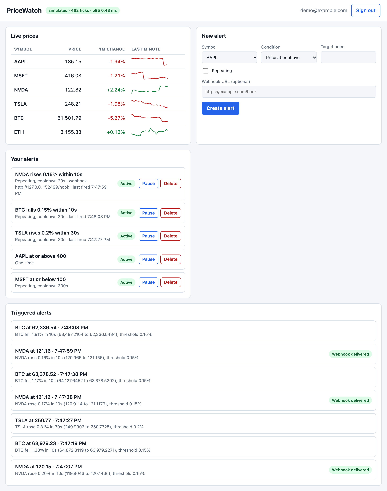

# PriceWatch

A real-time price alert platform. Create rules like "NVDA at or above 130" or "BTC falls 2% within
one minute", watch live prices on a dashboard, and get notified in the dashboard and, optionally,
through an HMAC-signed webhook.



Built with Python, Flask, SQLite (WAL), and vanilla JavaScript. No frontend framework, no CDN
assets, no message broker. Ticks flow through a partitioned in-process event bus that guarantees
per-symbol ordering.

* [Quickstart](#quickstart) · [Architecture](#architecture) · [API](#api) ·
  [Configuration](#configuration) · [Testing](#testing) · [Benchmarks](#benchmarks) ·
  [Design decisions](#design-decisions) · [Known limitations](#known-limitations)
* Deeper reading: [docs/ARCHITECTURE.md](pricewatch/docs/ARCHITECTURE.md),
  [docs/WALKTHROUGH.md](pricewatch/docs/WALKTHROUGH.md)

## Quickstart

Requires Python 3.11 or newer.

```bash
git clone <your-repo-url> pricewatch && cd pricewatch
python3 -m venv .venv && source .venv/bin/activate
pip install -r requirements.txt
python -m pricewatch
```

Open <http://127.0.0.1:8000>, choose **Create account**, then create an alert. A good first demo:
condition **Rises by at least %** on any symbol, **0.2 %** within **10 seconds**, tick *Repeating*.
The simulated feed includes occasional 1–2 % shocks, so it fires within a minute or so. The 1-minute
change column and sparklines fill in after the first minute of prices.

Set `PRICEWATCH_JWT_SECRET` to a long random string before exposing the app to anyone
(`python -c "import secrets; print(secrets.token_urlsafe(48))"`). Without it the app starts with an
insecure development secret and logs a warning.

### Docker

```bash
docker build -t pricewatch .
docker run -p 8000:8000 -e PRICEWATCH_JWT_SECRET="$(python3 -c 'import secrets; print(secrets.token_urlsafe(48))')" \
  -v pricewatch-data:/data pricewatch
curl http://127.0.0.1:8000/api/health
```

Run exactly one container: the feed and bus live in memory (see [limitations](#known-limitations)).

## Architecture

```
 Provider ──► FeedRunner ──► PriceStore ──► PartitionedBus ──► RuleEngine ──► SQLite (WAL)
 simulated /  thread,        latest price    crc32(symbol)%N    cached rules,  alerts, events
 CoinGecko    exp. backoff   + bisect-able   N threads, each    idempotent
                             history         with its queue     firing
                                                                    │
                                                                    ▼
                  Flask API + dashboard ◄─────── status ──── WebhookDispatcher
                  (reads store and DB)                       own queue + worker pool,
                                                             HMAC-signed, retries
```

1. **Feed**: a provider returns `{symbol: price}`; the runner polls it, backing off exponentially
   (up to 60 s) on failure and recovering by itself.
2. **Store**: latest price plus bounded history per symbol; rejects stale/duplicate timestamps;
   `bisect` lookup of "the price one window ago".
3. **Bus**: each symbol always maps to one worker thread, so ordering is guaranteed and per-symbol
   state needs no locks. Full queues drop the tick (counted) instead of blocking the feed.
4. **Rule engine**: `above`, `below`, `pct_rise`, `pct_drop`. One-time or repeating with a
   cooldown. Firing is one atomic transaction made idempotent by `UNIQUE(alert_id, tick_ts_ms)`.
5. **Webhooks**: separate queue and workers, so a dead endpoint never delays evaluation.

Full details and trade-offs: [docs/ARCHITECTURE.md](pricewatch/docs/ARCHITECTURE.md).

## API

All responses are JSON; errors look like `{"error": "..."}`. Authenticated endpoints need
`Authorization: Bearer <token>`.

| Method | Path | Auth | Description |
|---|---|---|---|
| POST | `/api/auth/register` | no | `{email, password}` → `{token, user}` (201) |
| POST | `/api/auth/login` | no | `{email, password}` → `{token, user}` |
| GET | `/api/prices?spark=60` | no | Latest prices, 1-minute change, optional sparkline (seconds, 1–600) |
| GET | `/api/prices/<symbol>/history?seconds=300` | no | `{symbol, points: [[ts_ms, price], …]}` |
| GET | `/api/alerts` | yes | The user's alerts |
| POST | `/api/alerts` | yes | Create an alert (max 50 per user) |
| GET | `/api/alerts/<id>` | yes | One alert (404 if not yours) |
| PATCH | `/api/alerts/<id>` | yes | Change `active`, `threshold`, `repeating`, `cooldown_seconds`, `webhook_url` only |
| DELETE | `/api/alerts/<id>` | yes | Delete (204) |
| GET | `/api/events?limit=50&before_id=…` | yes | Triggered alerts, newest first; `next_before_id` is the cursor |
| POST | `/api/events/<id>/retry` | yes | Re-queue a `failed` webhook delivery (202) |
| GET | `/api/health` | no | Feed status, bus stats (processed, dropped, errors, queue depths, p50/p95/p99), webhook counts |

Alert fields: `symbol`, `rule_type` (`above` / `below` / `pct_rise` / `pct_drop`), `threshold`
(price, or percent for pct rules), `window_seconds` (10–600, pct rules only), `repeating`,
`cooldown_seconds` (0–86400), `webhook_url` (optional).

```bash
BASE=http://127.0.0.1:8000

# sign up (use /api/auth/login for an existing account) and keep the token
TOKEN=$(curl -s -X POST $BASE/api/auth/register -H 'Content-Type: application/json' \
  -d '{"email":"me@example.com","password":"a-long-password"}' | python3 -c 'import sys,json; print(json.load(sys.stdin)["token"])')

# live prices with a one-minute sparkline
curl -s "$BASE/api/prices?spark=60"

# alert when NVDA rises 0.5% within 30 seconds, repeating with a 5 minute cooldown
curl -s -X POST $BASE/api/alerts -H "Authorization: Bearer $TOKEN" -H 'Content-Type: application/json' \
  -d '{"symbol":"NVDA","rule_type":"pct_rise","threshold":0.5,"window_seconds":30,"repeating":true,"cooldown_seconds":300}'

# price alert with a signed webhook
curl -s -X POST $BASE/api/alerts -H "Authorization: Bearer $TOKEN" -H 'Content-Type: application/json' \
  -d '{"symbol":"BTC","rule_type":"below","threshold":50000,"webhook_url":"https://example.com/hook"}'

# list, pause, and delete
curl -s $BASE/api/alerts -H "Authorization: Bearer $TOKEN"
curl -s -X PATCH $BASE/api/alerts/1 -H "Authorization: Bearer $TOKEN" -H 'Content-Type: application/json' -d '{"active":false}'
curl -s -X DELETE $BASE/api/alerts/1 -H "Authorization: Bearer $TOKEN"

# fired alerts, and retry a failed webhook delivery
curl -s "$BASE/api/events?limit=10" -H "Authorization: Bearer $TOKEN"
curl -s -X POST $BASE/api/events/1/retry -H "Authorization: Bearer $TOKEN"

# pipeline health
curl -s $BASE/api/health
```

### Webhooks

A POST with `Content-Type: application/json` and the header
`X-PriceWatch-Signature: sha256=<hex>`, where the hex is `HMAC-SHA256(secret, raw_body)`. The
secret is `PRICEWATCH_WEBHOOK_SECRET` (or a value derived from the JWT secret). Verify it on the
raw bytes:

```python
import hashlib, hmac


def verify(secret: bytes, body: bytes, header: str) -> bool:
    expected = "sha256=" + hmac.new(secret, body, hashlib.sha256).hexdigest()
    return hmac.compare_digest(expected, header)
```

Body: `{"event_id", "alert_id", "symbol", "price", "message", "fired_at", "rule": {...}}`.
A 2xx response marks the delivery successful; anything else is retried with exponential backoff
(default 3 attempts), then marked `failed` (retry it from the dashboard or the API). Redirects are
not followed. Webhook URLs must be public http(s) addresses (SSRF protection).

## Configuration

Environment variables, all optional:

| Variable | Default | Meaning |
|---|---|---|
| `PRICEWATCH_DB` | `pricewatch.db` | SQLite file |
| `PRICEWATCH_JWT_SECRET` | insecure dev value (warns) | Signs session tokens. **Set this.** |
| `PRICEWATCH_WEBHOOK_SECRET` | derived from JWT secret | Key for webhook signatures |
| `PRICEWATCH_FEED` | `simulated` | `simulated` or `coingecko` (crypto only: BTC, ETH, SOL, DOGE, ADA, XRP) |
| `PRICEWATCH_SYMBOLS` | `AAPL,MSFT,NVDA,TSLA,BTC,ETH` | Comma-separated |
| `PRICEWATCH_TICK_INTERVAL` | `1.0` | Seconds between polls (CoinGecko is never polled faster than every 10 s) |
| `PRICEWATCH_SEED` | random | Integer seed for a reproducible simulated feed |
| `PRICEWATCH_PARTITIONS` | `4` | Bus worker threads |
| `PRICEWATCH_HOST` / `PRICEWATCH_PORT` | `127.0.0.1` / `8000` | Bind address |
| `PRICEWATCH_ALLOW_PRIVATE_WEBHOOKS` | `0` | Tests only: allows localhost/private webhook targets (disables SSRF protection) |

See `.env.example`. The app reads the process environment; it does not load `.env` files itself.

To use live crypto prices: `PRICEWATCH_FEED=coingecko PRICEWATCH_SYMBOLS=BTC,ETH python -m pricewatch`.

## Testing

```bash
pip install -r requirements-dev.txt
python -m playwright install chromium   # optional: enables the dashboard browser test
ruff check . && ruff format --check .
pytest --cov=pricewatch --cov-report=term-missing
```

246 tests, 95% line coverage (measured on Python 3.12; the suite also passes on 3.11). What they
cover: password hashing, JWT forgery/expiry/`alg: none`, no user enumeration, input validation,
cross-user isolation, rule semantics (inclusive thresholds, cooldowns, percent windows with
insufficient history, replayed ticks, deleted alerts), bus ordering and overflow, feed backoff,
signed webhooks against a local stub server, SSRF cases, one end-to-end test through the real HTTP
server, a real-process start/SIGTERM/SIGINT test, and a Playwright browser test of the dashboard
(skipped automatically if no browser is available). `python -m pricewatch` itself is exercised by
the subprocess test, which coverage does not measure.

## Benchmarks

Run it yourself: `python scripts/loadtest.py all --json docs/benchmark-results.json`
(about 5 minutes). Full output is in [docs/benchmark-results.json](pricewatch/docs/benchmark-results.json).

**Machine:** Apple M4, 10 logical CPUs, 16 GB RAM, macOS 27.0.1, Python 3.12.16, run on 2026-11-04
with nothing else running. Numbers on other hardware will differ.

### Rule engine: 500 active alerts, 6 symbols, 4 bus partitions

Ticks go through the real path: price store → partitioned bus → rule engine. Latency is measured
by the bus from enqueue until rule evaluation completes. The producer shares a Python process (and
GIL) with the engine, so this is not a multi-process deployment figure.

*Evaluation only (no rule fires; mix of above/below/pct_rise/pct_drop with windows 10–600 s):*

| Mode | Sustained ticks/s | p50 | p95 | p99 | Ticks lost |
|---|---|---|---|---|---|
| Paced at 1,000/s | 1,000 | 0.69 ms | 2.18 ms | 2.95 ms | 0 |
| Paced at 2,000/s | 2,000 | 1.57 ms | 3.39 ms | 4.36 ms | 0 |
| Paced at 5,000/s | 4,999 | 1.99 ms | 3.92 ms | 4.46 ms | 0 |
| Saturation (as fast as the bus accepts) | 20,198 | 353 ms | 394 ms | 442 ms | 0 |

*10% of the rules (50) fire repeatedly with a 60 s tick-time cooldown, so the run also writes
events to SQLite (25,000 events in this scenario):*

| Mode | Sustained ticks/s | p50 | p95 | p99 | Ticks lost |
|---|---|---|---|---|---|
| Paced at 1,000/s | 1,000 | 1.28 ms | 2.86 ms | 12.24 ms | 0 |
| Paced at 2,000/s | 2,000 | 1.62 ms | 4.56 ms | 11.99 ms | 0 |
| Paced at 5,000/s | 4,999 | 1.81 ms | 6.53 ms | 92.06 ms | 0 |
| Saturation | 20,700 | 308 ms | 1,189 ms | 1,237 ms | 0 |

How to read this:

* **Paced rows answer "how long does a tick wait at this load?"** At 1,000 ticks/s with 500 active
  rules, p95 was 2.18 ms with no rule firing and 2.86 ms with 10% of rules firing.
* **Saturation rows are a capacity figure** (about 20,000 ticks/s). Their latency is dominated by
  time spent waiting in full queues; it is not the cost of evaluating one tick. Nothing was lost
  because the producer waits when a queue is full.
* The tail grows when many rules fire at once (p99 of 92 ms at 5,000 ticks/s with 25,000 events
  written): SQLite allows one writer at a time, so firing is the bottleneck, not evaluation.
* This simulated feed produces 6 ticks per second, so these rates are far above what the app
  sees in normal use; they show headroom.

### HTTP API: 8 client processes, 1,000 requests each, real server process

| Endpoint | Requests/s | p50 | p95 | p99 | Errors |
|---|---|---|---|---|---|
| `GET /api/prices?spark=60` | 4,083 | 1.88 ms | 2.33 ms | 2.88 ms | 0 |
| `GET /api/health` | 3,823 | 2.00 ms | 2.55 ms | 2.99 ms | 0 |
| `GET /api/alerts` (authenticated, 20 alerts) | 880 | 9.10 ms | 12.07 ms | 13.97 ms | 0 |

Werkzeug closes the connection after every response, so each request includes a TCP connect. The
authenticated endpoint is slower because each request runs on a fresh thread and opens its own
SQLite connection, then does two queries (user check, alert list); prices and health touch no
database. The load generator sends a fixed number of requests with a cooldown between endpoints to
stay inside the OS ephemeral-port budget: an earlier version that ran for a fixed duration produced
connection errors from port exhaustion, and I treated those runs as invalid.

## Design decisions

* **One process, in-memory pipeline.** No broker to operate and no cross-process ordering problem.
  The cost is that it cannot scale horizontally; the upgrade path (PostgreSQL, then Kafka keyed by
  symbol) is described in [docs/ARCHITECTURE.md](pricewatch/docs/ARCHITECTURE.md) and deliberately not built.
* **Partition by `crc32(symbol)`.** One thread owns each symbol: ordering for free, no locks on
  rule state. `crc32` instead of `hash()` because Python randomizes string hashes per process.
* **Bounded queues that drop, never block.** The feed must not stall behind a slow consumer.
  Drops are counted and visible in `/api/health`.
* **Idempotent firing in the database.** `UNIQUE(alert_id, tick_ts_ms)` with `INSERT OR IGNORE`
  inside `BEGIN IMMEDIATE`, so replaying a tick cannot create a duplicate event or webhook.
* **Cooldown in tick time**, so behavior is deterministic and testable with fixed timestamps.
* **Webhooks on their own worker pool**, so a dead endpoint never delays rule evaluation.
* **Security by default.** PBKDF2 with per-user salts, JWTs with a pinned algorithm, identical
  login errors plus a dummy hash (no user enumeration), per-user scoping (404, not 403), SSRF
  validation at save and at delivery, strict CSP with no inline code, no `innerHTML`.
* **SQLite in WAL mode**, one connection per thread. Zero setup; the single writer is not a
  bottleneck at this scale (see the benchmark's firing scenario).

## Known limitations

* **Single process.** Do not run several instances against one database. Price history is in
  memory and refills after a restart (percent rules stay quiet until their window is covered).
* **Dev-grade HTTP server.** Werkzeug's server closes the connection after every response and
  is not meant for the public internet; put it behind a reverse proxy, or swap in a production
  WSGI server (for example waitress) and keep it to a single process.
* A small DNS-rebinding race remains between the delivery-time URL check and the HTTP library's own
  lookup.
* One server-wide webhook signing secret rather than one per user.
* Events left `pending` by a crash are not re-queued at startup.
* Login rate limiting is per socket address and in memory (behind a proxy all clients share one).
* Registration reveals whether an email is already taken (login does not).
* No event retention policy; the dashboard polls instead of using push.

## License

MIT
